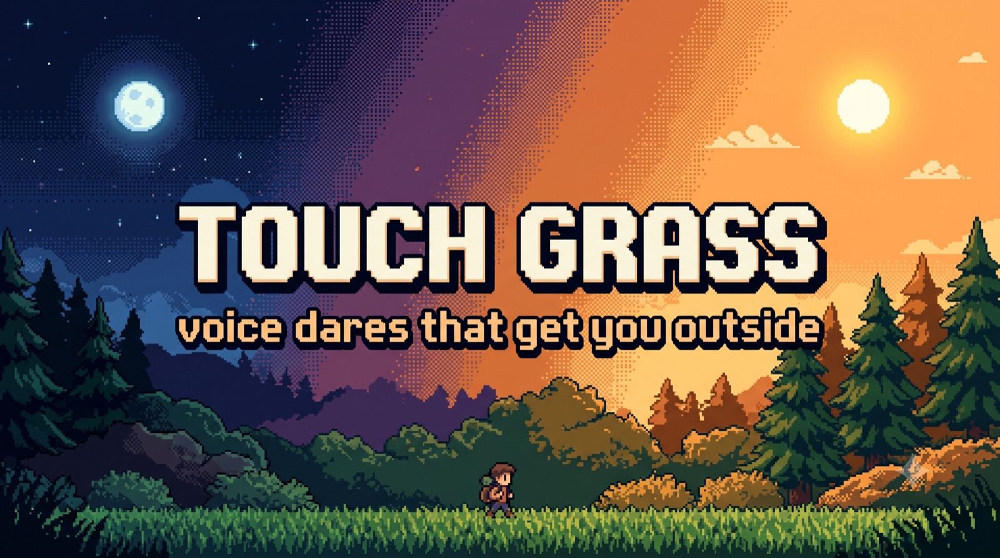
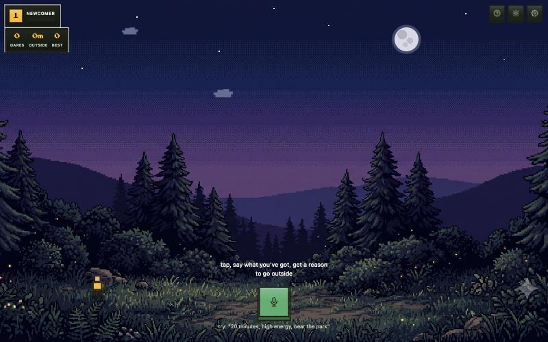
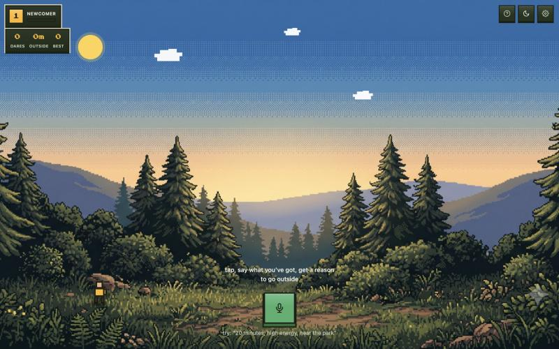

<div align="center">

# Touch Grass

### Say what you've got. Get one dare. Go outside.

[](./LICENSE)
[](https://dev.to/challenges/hacktoberfest-week1-2026-10-05)
[](https://huggingface.co/onnx-community/gemma-3-270m-it-ONNX)
[](#contributing)

[**Live demo**](https://touch-grass-bkii.onrender.com) · [**DEV write-up**](https://dev.to/ibrahimiqbal/touch-grass-voice-dares-that-get-you-off-the-screen-running-on-device-with-gemma-3-270m-fi5)

</div>

<p align="center">
  
</p>

<p align="center">
  <sub><em>a voice-first dare PWA. Pixel-art world. On-device Gemma. One dare, go outside, come back later.</em></sub>
</p>

---

Anyone who opens their phone meaning to do one quick thing and surfaces 40 minutes later having done none of them. Tell it you've got 10 minutes and low energy; it won't hand you a half-marathon. Finish the dare, snap a photo as proof, and it counts toward a daily streak. No feed, no infinite scroll, no "just one more dare" loop.

The whole app is a little outdoor world you stand in. Painted pixel-art scene fills the screen, your character stands in the grass, the controls pin to the edges like a game HUD.

<p align="center">
  
  
</p>

<p align="center">
  <sub><em>flip the theme and the same world re-lights from cozy night to warm day — backdrop crossfades, the moon slides out, the sun comes up.</em></sub>
</p>

## Features

- **Voice-first.** Tap the mic, say your time and energy, a dare slides up in a dialogue ribbon tagged with roughly how long it takes and how much energy it costs.
- **Camera proof + daily streak.** "Prove it outside" button opens the camera with a defensive timeout (confirmed: `getUserMedia` can hang indefinitely on cameraless devices).
- **Three dare layers, from offline-floor to smart-ceiling.**
  - *Default:* curated dare bank (`dares.json`) matched by time/energy/place. Always works, offline, zero setup.
  - *Smart (optional):* [Gemma 3 270M](https://huggingface.co/onnx-community/gemma-3-270m-it-ONNX) via transformers.js — bring your own free Hugging Face token, runs fully client-side via WASM.
  - *Voice (optional):* ElevenLabs — your key, used directly from your browser.
- **PWA with full offline.** Service worker caches app shell + model after first load. Works on a trail with no signal, which is the point.
- **Day/night theme.** Backdrop crossfades, sliding sun/moon, drifting clouds, foliage that fills in as your streak grows.
- **Cross-origin isolation (COOP/COEP)** on the Render deploy for the full WASM execution path.

## Try it

**Live:** <https://touch-grass-bkii.onrender.com>

Or run locally (no build step):

```bash
git clone https://github.com/ibrahim-iqbal/touch-grass-hf26-wk1.git
cd touch-grass-hf26-wk1
python3 -m http.server 8000
```

Then open <http://localhost:8000>.

## Stack

- **UI:** vanilla HTML/CSS/JS, no framework, no build step
- **Smart layer:** [transformers.js](https://huggingface.co/docs/transformers.js) + [Gemma 3 270M (ONNX)](https://huggingface.co/onnx-community/gemma-3-270m-it-ONNX), WASM-only client-side
- **Voice input:** Web Speech API (Chrome/Edge)
- **Voice output:** `speechSynthesis` by default, ElevenLabs optional
- **Camera:** `getUserMedia` + canvas (HTTPS required)
- **Offline:** service worker precache for shell + model
- **Deploy:** Render static site with COOP/COEP headers

## Honest limits

- Voice input needs a Chromium browser (Web Speech is patchy elsewhere).
- Smart dare mode needs a Hugging Face token; the curated bank is the floor if you don't want to.
- Camera proof needs HTTPS, satisfied on the live link.

## Acknowledgements

- **[Gemma 3 270M](https://huggingface.co/onnx-community/gemma-3-270m-it-ONNX)** by Google — the open-weight model.
- **[transformers.js](https://github.com/huggingface/transformers.js)** by Hugging Face.
- **[ElevenLabs](https://elevenlabs.io)** — optional, nicer voice.
- **[Render](https://render.com)** — static hosting with COOP/COEP headers.
- **The Hacktoberfest Open-Source AI Challenge Week 1** — the forcing function.

## License

[MIT](./LICENSE).

---

<p align="center">
  <sub><em>crafted by <a href="https://github.com/ibrahim-iqbal">ibrahim-iqbal</a> · <a href="https://dev.to/ibrahimiqbal">dev.to</a></em></sub>
</p>
